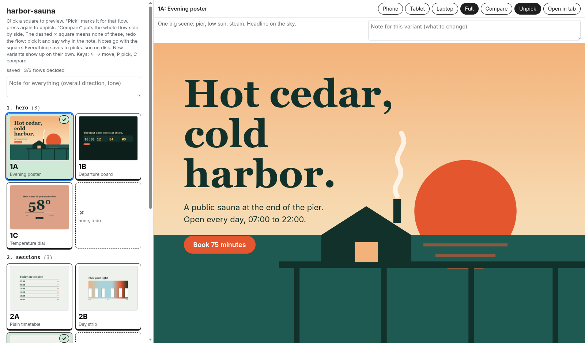
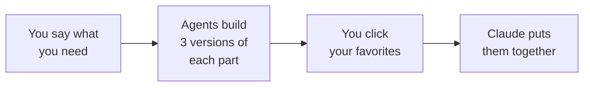
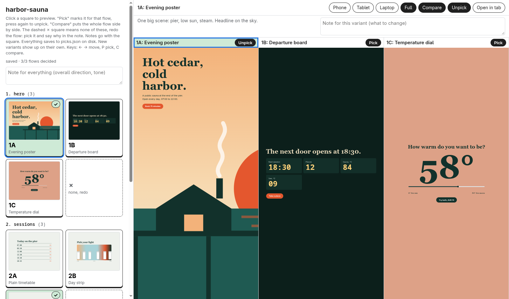
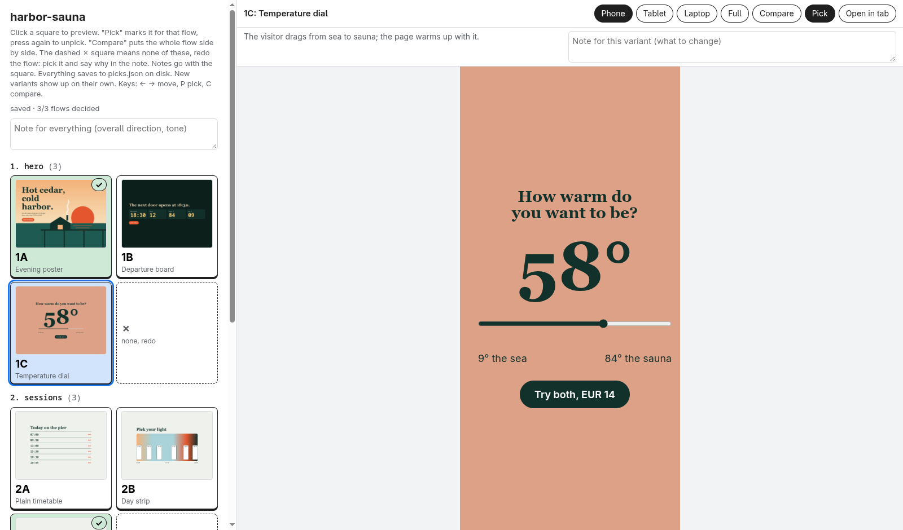

<div align="center">


# variant-picker

**A Claude Code skill for work you judge by eye. Parallel agents build three real versions of every part.
You click the squares you like, and Claude assembles the result.**

[](SKILL.md)
[](scripts/gallery.py)
[](scripts/gallery.html)
[](SKILL.md)
<br>
[](#the-numbers)
[](#limits)
[](LICENSE)

[Problem](#the-problem) · [Solution](#the-solution) · [Numbers](#the-numbers) · [Quickstart](#quickstart) ·
[Limits](#limits) · [For AI agents](#for-ai-agents)

<br>



</div>

## The problem

Making something visual with AI tends to get stuck in one of two loops.

### Loop 1: you keep asking

You ask for a landing page and get one. It's fine, but it isn't what you wanted. So you type "bigger", then "calmer",
then "no, not like that", and the same draft gets patched ten times. You never find out what the other
pages could have looked like.

### Loop 2: the AI keeps judging itself

To save you from loop 1, people add judges. One agent builds, another scores it, a third fixes what the second
disliked, and it all starts over. You wait and pay for every round. At the end you still get one version, polished
to the taste of a model, and you still have to say whether you like it.

A judge can tell you that a button is cut off on a phone. It doesn't know which hero you'd like better.

## The solution

variant-picker skips both loops. You get several different versions up front and choose by looking at them.



1. **Say what you need.** Claude asks a few questions and splits the job into parts, like the hero or the prices. If you
   don't say how it should look, you pick one of three overall looks first.
2. **Wait.** Each part gets its own agent, and each agent makes three versions with different ideas behind them.
3. **Click.** Every version is a numbered square on a page on your computer. Pick `1A`, `2C`, `3B`. Leave a note if
   something is almost right, or press ✗ if none of them fit.
4. **Get the result.** Claude joins your picks into one page or deck and applies your notes. Only the parts you
   flagged go another round.

Agents still look at their own screenshots and fix what's broken before you pick. Taste is left to you.

<table>
  <tr>
    <td width="50%"></td>
    <td width="50%"></td>
  </tr>
  <tr>
    <td align="center"><sub>Compare mode: all versions of one part side by side</sub></td>
    <td align="center"><sub>Phone, tablet, laptop and full width previews</sub></td>
  </tr>
</table>

<sub>The sauna is invented. Claude wrote these nine variants directly as a demo, without a skill run:
[`examples/harbor-sauna`](examples/harbor-sauna).</sub>

## The numbers

These come from two of my own projects in November 2026, an event website and a pitch deck. They aren't every run
I've done. The website is the build this skill was written from, and the pitch deck used the skill itself.

<table align="center">
  <tr>
    <td align="center" width="25%"><h2>86</h2>versions built</td>
    <td align="center" width="25%"><h2>28</h2>website sections<br>and slides to choose</td>
    <td align="center" width="25%"><h2>14 of 28</h2>times I didn't pick<br>the first version</td>
    <td align="center" width="25%"><h2>38.2 min</h2>for 42 slide versions<br>by 15 agents</td>
  </tr>
</table>

Half the time I picked something other than the first version. That's one person and two projects with nothing to compare against, so it doesn't prove the results are better.

<details>
<summary><b>Both projects, and how they were counted</b></summary>

Claude counted folders on disk and read times from session logs.

| Project | Parts | Versions | Agents | Launch to last agent back | Picked A / B / C |
|---|---:|---:|---:|---:|---:|
| Event website (two sites) ¹ | 14 | 44 | 18 | 38.5 min | 6 / 4 / 4 |
| Pitch deck, slide by slide ² | 14 | 42 | 15 | 38.2 min | 8 / 2 / 4 |
| **Total** | **28** | **86** | | | **14 / 6 / 8** |

¹ The first files landed 3 minutes after launch, and I pasted my picks 56 minutes after launch. Four of the 18
agents did prep work, and one of those also made a PDF that isn't counted here.<br>
² One of the 15 agents did research. Two whole-deck rounds on the same project aren't counted, because the pick was
typed in chat or first written by an agent.

</details>

<details>
<summary><b>What research says about the two loops</b></summary>

None of these studies tested this skill.

Loop 1:

- People shown one design rated it higher and criticized it less than people who saw it in a group of three. 48
  participants, [Tohidi et al., CHI 2006][tohidi].
- People who made several ad prototypes before getting feedback got 445 clicks per million impressions. Those who
  improved one at a time got 398. 33 participants, [Dow et al., TOCHI 2010][dow].
- LLM scores fell 39% on average when a task was revealed over several turns instead of all at once. These were
  simulated analytic tasks and the authors did not test creative work. [Laban et al., 2025][laban].

Loop 2:

- LLMs struggled to fix their own reasoning without outside feedback, and sometimes got worse.
  [Huang et al., ICLR 2024][huang].
- A survey found that self-correction works well when the feedback is reliable and external. Outside of tasks that
  especially suit it, it found no work showing success with feedback from prompted LLMs alone.
  [Kamoi et al., TACL 2024][kamoi].
- LLM evaluators can score their own output higher even when people rate it as equal.
  [Panickssery et al., 2024][panickssery].
- On the other side, strong LLM judges agreed with people over 80% of the time on chat answers.
  [Zheng et al., NeurIPS 2023][zheng]. Judges can be useful. I just don't want one choosing my design.

Why three versions: one review of choice overload found [almost no average effect][scheibehenne], another found
[a real one when the choice is hard or preferences are unclear][chernev]. Three is my default, small enough to see at
once.

</details>

## Quickstart

You need [Claude Code](https://claude.com/claude-code), Python 3 and Google Chrome.

```sh
git clone https://github.com/Farckron/variant-picker ~/.claude/skills/variant-picker
```

It keeps itself up to date: each time you use it, Claude pulls the latest version from this repo first. If you have
edited the files yourself, or want to stay on one version, see [updates](#updates).

Then ask for something in Claude Code:

```text
/variant-picker Landing page for my climbing gym. Facts are in facts.md.
```

Want to see the picker first? This opens the demo, with no agents and no tokens spent:

```sh
cd ~/.claude/skills/variant-picker
python3 scripts/gallery.py examples/harbor-sauna
```

Open the link it prints. Arrow keys move between squares, `P` picks, `C` compares.

### Updates

Every push to `main` reaches you the next time you run the skill. Claude may ask for permission to run the `git pull`.
It never overwrites your own edits: if the pull can't go through cleanly, you stay on the version you have. To stay on
one version on purpose, check out a commit (`git checkout <commit>`). If you downloaded the ZIP, replace it with the
`git clone` above, because a ZIP can't update itself.

## Limits

- It uses a lot of tokens, because many agents work at once. Use it where the choice matters.
- Good parts don't always make a good whole. Look at everything together before you call it done.
- For one bug or one paragraph, just ask Claude.
- The joining step is documented for websites. For decks, documents and code, Claude writes it for your project.
- The picker runs only on your computer and has no login. Point it at a separate work folder.
- I've only run it on Linux with Python 3.14.

Similar tools: [gstack's design-shotgun](https://github.com/garrytan/gstack/blob/main/design-shotgun/SKILL.md) and the
visual companion in [superpowers](https://github.com/obra/superpowers).

Made by **Serhii** ([@Farckron](https://github.com/Farckron)). MIT, see [LICENSE](LICENSE).

## For AI agents

Humans can stop here. Start with [SKILL.md](SKILL.md). Below is what you won't get from a quick read of it.

```text
FILES   SKILL.md=procedure | scripts/gallery.py=server | scripts/gallery.html=UI |
          references/contract-template.md
        =>CONTRACT.md | references/workflow-template.js=Workflow fan-out |
          references/web-sections.md=web assembly
ORDER   server up -> CONTRACT+facts+shared -> [00-direction iff no look ref; pick; excl. from
          assembly] -> fan-out
        (1 agent/flow; >16 total => ask) -> picks.json -> assemble -> redo only {none,
          unpicked, noted}
UPDATE  SKILL.md "Update first": ff-only pull of main iff $D/.git is a dir (guards against
          pulling an enclosing dotfiles repo). Detached HEAD, dirty conflict or offline =>
          keep local, continue. After "updated" re-read SKILL.md: your loaded copy is stale.
RUN     gallery.py ROOT [PORT=8765] [--on-pick CMD]; port busy => random free port: parse
          stdout, never assume.
        GET /_pick/ | GET /_pick/gallery.json | GET,POST /_pick/picks (exact path; ?query on
          POST => 404)
SCAN    ROOT/variants/<NN-flow>/<V>/ ; live per request; UI polls 4s, paused while tab hidden.
        flow.key=dirname; n=int(NN prefix), no prefix => sort position; card.id=f"{n}{V}".
        ! same NN on two flows => colliding card ids => shared notes. Never renumber after
          fan-out.
        ! EVERY subdir of a flow is a card: no assets/ beside A/ B/ C/. Put it inside the
          variant or in ROOT/shared.
        ! ROOT/gallery.json disables scan entirely: new variants/thumbs stay invisible until
          the build reruns. Invalid JSON there => connection dropped, no HTTP status. Write
          tmp + os.replace.
        gallery.json={title,flows:[{n,flow,key,cards:[{id,v,title,desc,href,thumb}]}]}; hrefs
          root-absolute.
PREVIEW first match: preview.html index.html preview.{png,jpg,webp,gif,svg,pdf,mp4,md,txt}.
          thumb.{png,jpg,webp}.
        NOTES.md: L1 title, L2-3 desc (cut at 300 chars). No preview file => card shows,
          href="".
PICKS   {"picks":{flow.key:V|"none"},"notes":{card.id|flow.key|"*":text}}. Flat str:str,
          body<=100000 B,
        Content-Type must contain json (else 403), other top-level keys => 400.
        ! POST REPLACES the whole file; an omitted "picks" wipes picks. No flow/variant check:
          validate on read, fall back when a picked V is gone.
        ! An open tab owns the state: it reads picks once at load and POSTs its full copy.
          Anything you write to picks.json is overwritten by the next click. Ask for a reload,
          or don't write.
        Note on "none" is keyed by flow.key, not card id. Unpick deletes the key, notes stay.
ON-PICK shell=True, cwd=ROOT, fires iff picks changed (not notes), synchronous before the 200;
          exit code ignored;
        no lock between parallel POSTs. Must be fast, idempotent and atomic. A failing build
          is silent: check output.
SEC     binds 127.0.0.1; Host must be 127.0.0.1|localhost ([::1] => 403); Origin checked on
          POST only. Directory
        listing on, symlinks followed out of ROOT => no secrets or repo root under ROOT.
          Preview iframes are
        same-origin and unsandboxed: variant JS can POST picks. Don't load untrusted variants.
WEB     root [data-v="<flow>-<V>"], all selectors scoped to it, keyframes prefixed <flow><V>-,
          IIFE that returns if
        root is missing, no globals. In-context preview = current picks with one flow swapped.
QA      390+1440 px shots via the running server (no second server); thumb last, 1440x1080
          @0.5 => 720x540, then
        rebuild if gallery.json exists. Return {variants:[{v,title,summary}],known_issues}. No
          judge agents.
DONE    picks "none"/absent => not final: placeholder = first variant, tell the user. Stop the
          server at the end.
```

[tohidi]: https://doi.org/10.1145/1124772.1124960
[dow]: https://doi.org/10.1145/1879831.1879836
[laban]: https://arxiv.org/abs/2505.06120
[scheibehenne]: https://doi.org/10.1086/651235
[chernev]: https://www.kellogg.northwestern.edu/faculty/research/detail/2015/when-product-assortment-leads-to-choice-overload-a-conceptual
[huang]: https://arxiv.org/abs/2310.01798
[kamoi]: https://doi.org/10.1162/tacl_a_00713
[panickssery]: https://arxiv.org/abs/2404.13076
[zheng]: https://arxiv.org/abs/2306.05685
